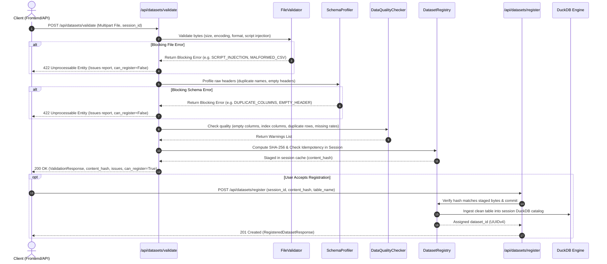

# Implementation Guide: CSV Validation Pipeline & Dataset Identity

## 1. Directory Structure

```
backend/
├── app/
│   ├── __init__.py
│   ├── main.py                     # FastAPI application entrypoint
│   ├── config.py                   # Environment settings & thresholds
│   ├── models/
│   │   ├── __init__.py
│   │   └── dataset.py              # Pydantic schemas (ValidationResponse, Issues, etc.)
│   ├── validation/
│   │   ├── __init__.py
│   │   ├── file_validator.py       # Format, size, encoding, stream parse, script checks
│   │   ├── schema_profiler.py      # Raw headers, duplicate columns, empty headers, types
│   │   ├── data_quality.py         # Empty cols, index cols, duplicate rows, anomalies
│   │   └── dataset_registry.py     # Session registry, SHA-256 hash, UUID, TOCTOU staging
│   └── api/
│       ├── __init__.py
│       └── datasets.py             # HTTP routes (/api/datasets/validate, /register)
├── tests/
│   ├── __init__.py
│   ├── conftest.py
│   ├── test_file_validator.py
│   ├── test_schema_profiler.py
│   ├── test_data_quality.py
│   └── test_dataset_api.py
├── pyproject.toml
└── requirements.txt
```

---

## 2. Validation Flow Sequence



---

## 3. Issue Codes & Severity Matrix

| Issue Code | Severity | Description | Actionable Recommendation |
|---|---|---|---|
| `EMPTY_FILE` | **BLOCKING** | File has 0 bytes. | Provide a non-empty CSV file. |
| `FILE_TOO_LARGE` | **BLOCKING** | File exceeds configured limit (e.g., 50MB). | Compress or filter dataset rows. |
| `UNSUPPORTED_FORMAT` | **BLOCKING** | Non-CSV / Excel file extension or MIME. | Upload a `.csv` or `.xlsx` file. |
| `INVALID_ENCODING` | **BLOCKING** | File bytes cannot be decoded. | Save CSV with UTF-8 encoding. |
| `MALFORMED_CSV` | **BLOCKING** | CSV stream syntax error or delimiter mismatch. | Verify row quoting and escaping. |
| `SCRIPT_INJECTION_RISK` | **BLOCKING** | Detected `<script>` tags or formula injection (`=cmd\|...`). | Remove executable formulas or tags. |
| `DUPLICATE_COLUMNS` | **BLOCKING** | Multiple columns have identical header names. | Rename duplicate column headers in the CSV. |
| `EMPTY_COLUMN_HEADER` | **BLOCKING** | Header row contains empty/blank column names. | Provide descriptive names for all column headers. |
| `FULLY_EMPTY_COLUMN` | **WARNING** | All values in column are NULL or whitespace. | Column contains no data and will provide no analytical value. |
| `LIKELY_INDEX_COLUMN` | **WARNING** | Column matches `Unnamed: 0` or row index sequence. | Column appears to be an exported dataframe index. |
| `DUPLICATE_ROWS` | **WARNING** | Row matches another row across all fields. | Verify if duplicate records should be deduplicated. |
| `HIGH_MISSING_RATE` | **WARNING** | Column has >20% missing values. | Queries filtering on this column may drop significant data. |
| `MIXED_TYPES` | **WARNING** | Column contains values of conflicting types. | Verify consistency of data entries. |
