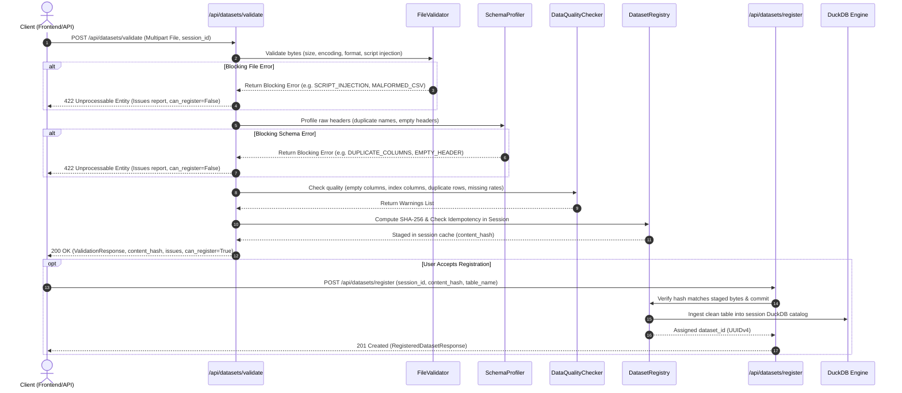
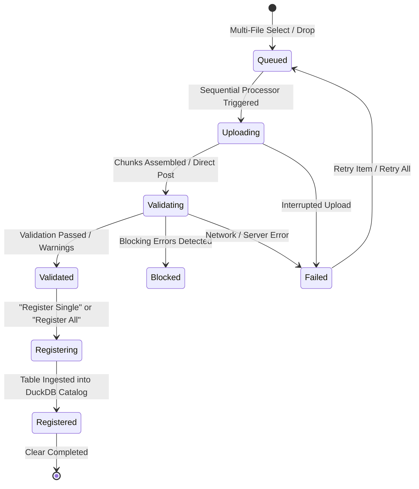

# Implementation Guide: CSV Validation Pipeline & Dataset Identity

## 1. Directory Structure

```
backend/
├── app/
│   ├── __init__.py
│   ├── main.py                     # FastAPI application entrypoint
│   ├── config.py                   # Environment settings & thresholds
│   ├── models/
│   │   ├── __init__.py
│   │   └── dataset.py              # Pydantic schemas (ValidationResponse, Issues, etc.)
│   ├── validation/
│   │   ├── __init__.py
│   │   ├── file_validator.py       # Format, size, encoding, stream parse, script checks
│   │   ├── schema_profiler.py      # Raw headers, duplicate columns, empty headers, types
│   │   ├── data_quality.py         # Empty cols, index cols, duplicate rows, anomalies
│   │   └── dataset_registry.py     # Session registry, SHA-256 hash, UUID, TOCTOU staging
│   └── api/
│       ├── __init__.py
│       └── datasets.py             # HTTP routes (/api/datasets/validate, /register)
├── tests/
│   ├── __init__.py
│   ├── conftest.py
│   ├── test_file_validator.py
│   ├── test_schema_profiler.py
│   ├── test_data_quality.py
│   └── test_dataset_api.py
├── pyproject.toml
└── requirements.txt
```

---

## 2. Validation Flow Sequence



---

## 3. Issue Codes & Severity Matrix

| Issue Code | Severity | Description | Actionable Recommendation |
|---|---|---|---|
| `EMPTY_FILE` | **BLOCKING** | File has 0 bytes. | Provide a non-empty CSV file. |
| `FILE_TOO_LARGE` | **BLOCKING** | File exceeds configured limit (e.g., 50MB). | Compress or filter dataset rows. |
| `UNSUPPORTED_FORMAT` | **BLOCKING** | Non-CSV / Excel file extension or MIME. | Upload a `.csv` or `.xlsx` file. |
| `INVALID_ENCODING` | **BLOCKING** | File bytes cannot be decoded. | Save CSV with UTF-8 encoding. |
| `MALFORMED_CSV` | **BLOCKING** | CSV stream syntax error or delimiter mismatch. | Verify row quoting and escaping. |
| `SCRIPT_INJECTION_RISK` | **BLOCKING** | Detected `<script>` tags or formula injection (`=cmd\|...`). | Remove executable formulas or tags. |
| `DUPLICATE_COLUMNS` | **BLOCKING** | Multiple columns have identical header names. | Rename duplicate column headers in the CSV. |
| `EMPTY_COLUMN_HEADER` | **BLOCKING** | Header row contains empty/blank column names. | Provide descriptive names for all column headers. |
| `FULLY_EMPTY_COLUMN` | **WARNING** | All values in column are NULL or whitespace. | Column contains no data and will provide no analytical value. |
| `LIKELY_INDEX_COLUMN` | **WARNING** | Column matches `Unnamed: 0` or row index sequence. | Column appears to be an exported dataframe index. |
| `DUPLICATE_ROWS` | **WARNING** | Row matches another row across all fields. | Verify if duplicate records should be deduplicated. |
| `HIGH_MISSING_RATE` | **WARNING** | Column has >20% missing values. | Queries filtering on this column may drop significant data. |
| `MIXED_TYPES` | **WARNING** | Column contains values of conflicting types. | Verify consistency of data entries. |

---

## 4. Multi-File Selection & Batch Upload Queue Architecture

To support seamless ingestion of multi-table analytical schemas (e.g. 8 related ecommerce tables), the system incorporates a visual batch upload queue engine with sequential execution guarantees.

### 4.1 Ingestion Flow & Concurrency Model



### 4.2 Architecture Guarantees

1. **Sequential Queue Processing & DuckDB Lock Safety:**
   - Files are validated and registered sequentially in queue order.
   - DuckDB tenant databases enforce single-writer locks on disk (`catalog.duckdb`). By processing batch items sequentially, the system completely prevents lock contention (`Conflicting lock is held`) and race conditions.

2. **Adaptive File Handling (Direct vs. Multipart Resumable):**
   - **Files &le; 5 MB:** Streamed directly to `/api/datasets/validate` in a single multipart request for instantaneous schema profiling.
   - **Files &gt; 5 MB:** Split into 5 MB chunks, tracked by manifest on disk (`/api/datasets/upload/init`, `/api/datasets/upload/chunk`), verified via SHA-256 upon assembly (`/api/datasets/upload/complete`), and resilient to network dropouts with chunk-level pause and resume.

3. **TOCTOU Safety & Idempotency:**
   - Every file's raw byte stream is hashed (SHA-256) upon validation and staged in a secure session cache.
   - When registering—either individually or via bulk `/api/datasets/register-batch`—the registry matches the client-submitted `content_hash` against staged bytes before committing to DuckDB, ensuring no byte-tampering can occur between validation and catalog registration.
   - If a byte-identical file is uploaded repeatedly or across multiple queue entries, idempotency detection returns the existing registration without duplicating table storage.

---

## 5. Batch Ingestion API Reference

### `POST /api/datasets/register-batch`

Registers a batch of pre-validated, staged datasets into the tenant's persistent DuckDB catalog in a single atomic transaction.

**Headers:**
- `Content-Type: application/json`
- `X-Tenant-ID: <tenant_id>`

**Request Body (`BatchRegisterRequest`):**
```json
{
  "items": [
    {
      "session_id": "sess_ecommerce_2024",
      "content_hash": "a1b2c3d4e5f6...",
      "table_name": "orders"
    },
    {
      "session_id": "sess_ecommerce_2024",
      "content_hash": "9f8e7d6c5b4a...",
      "table_name": "products"
    }
  ]
}
```

**Response (`200 OK` - `BatchRegisterResponse`):**
```json
{
  "registered": [
    {
      "dataset_id": "ds_550e8400-e29b-41d4-a716-446655440000",
      "session_id": "sess_ecommerce_2024",
      "table_name": "orders",
      "filename": "orders.csv",
      "content_hash": "a1b2c3d4e5f6...",
      "row_count": 50000,
      "column_count": 12,
      "registered_at": "2026-10-21T14:30:00Z",
      "columns": ["order_id", "customer_id", "order_date", "total_amount"]
    }
  ],
  "errors": []
}
```

